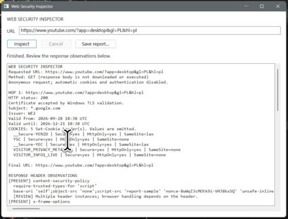

# Web Security Inspector

A native Windows app for inspecting HTTP response metadata. Built as a C++ cybersecurity portfolio project to explore HTTPS, redirects and browser security headers.

[](https://github.com/Kredickoa/web-security-inspector/raw/refs/heads/main/demo/demo.mp4)

[Watch the demo video](https://github.com/Kredickoa/web-security-inspector/raw/refs/heads/main/demo/demo.mp4)

## Highlights

- Shows HTTP status, redirect chains and HTTPS certificate details.
- Reviews security header presence and cookie attributes while omitting cookie values.
- Runs requests in the background and exports a UTF-8 text report.

## Stack

C++17, Windows API, WinHTTP, Windows certificate APIs and CMake. No third-party HTTP or GUI framework.

## Run locally

Requires Windows, CMake 3.16+ and a C++17 compiler. In Visual Studio Developer Command Prompt:

```cmd
cmake -S . -B build
cmake --build build --config Release
build\Release\web-security-inspector.exe
```

Enter a URL, click **Inspect**, then use **Save report** to export observations.

Uses anonymous GET requests, Windows certificate validation and up to five redirects. HTTPS-to-HTTP downgrades are not followed. Cancel takes effect after the current network request. Direct connections only; use ASCII/punycode hostnames.

Observes response metadata without running JavaScript or using a browser session. Missing headers are not confirmed vulnerabilities, and header presence does not establish an effective policy. This is not a complete security audit.

## Rights

All rights reserved. Shared for portfolio review; reuse requires prior written permission. See [LICENSE](LICENSE).
